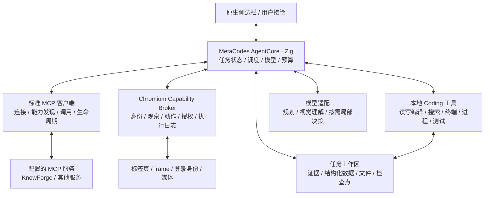

# MetaBrowser 系统架构

2026-10-15 · 系统目标架构与实现边界。当前已接入 MetaCodes provider/coding、标准 MCP、原生网页工具与 A2A；目标中的进程隔离、完整跨站业务、媒体和动态输入仍未完成。实际接口见 TOOLS.md 开头和 AGENT_PROTOCOL.md。

## 1. 一个任务运行时，统一组织网站与代码

MetaBrowser 是独立的原生 Chromium 浏览器。MetaCodes AgentCore 是唯一任务执行核心：同时使用标准 MCP 服务、浏览器、工作目录、代码执行和多模态模型。侧边栏呈现同一任务的计划、证据、文件、执行进度、人工交接和结果。跨网站只是任务中的步骤，不为每个网站建立互不相通的聊天代理。

站点知识负责方法，页面观察负责当前事实，宿主授权负责可执行范围。三者分别保存；远端文档中的风险标记、脚本注释或网页文字不能自行授予权限。

## 2. 模块职责与原生边界

| 模块 | 职责与接口 |
|---|---|
| Chromium Broker，C++/Mojo | 标签、profile 身份句柄、frame、观察世代、原生输入、文件交接、权限、输入释放、动作日志；网页不能直接调用内部桥 |
| AgentCore Host，Zig | 复用完整 MetaCodes SDK；统一任务状态、工具注册、调度、取消、预算、模型上下文与恢复 |
| MCP Client | 按标准协议连接配置的服务、发现与调用其能力，适配结果、权限、超时、取消与连接生命周期；不解释成专用站点包 |
| Coding Host | 复用 MetaCodes 文件与终端能力，运行计算、脚本、测试、生成报告；管理子进程、输出、超时与工作目录 |
| Task Store | 保存任务事实、假设、实体关联、文件、来源和执行检查点；业务数据不自动上传公共站点知识库 |
| Model Adapter | 将 typed text/image/table/artifact 结果交给模型，返回结构化工具调用；不同模型共用相同执行协议 |

目标部署将 AgentCore 放在独立原生 utility 进程，通过经过身份校验的本地 IPC 接入 Broker；代码运行在受管理的子进程中。浏览器 UI 不等待同步模型请求。Chromium renderer 保留沙箱。

当前原型仍是浏览器进程中的 Zig 动态库：原生 Views → 异步 C++ Session host → 专用工作线程 → AgentCore ABI 21。进程隔离是待实现接口，不是当前已有的保证。产品不依靠 Python 包装、Node 浏览器壳或外部 CDP 控制器；用户 coding 任务可以调用安装好的 Python、JS 等工具，这与产品运行时语言无冲突。

## 3. 标准 MCP 与本地 Skill

Skill 保持本地，沿用 MetaCodes 的加载机制；本次不设计远端 Skill 分发、站点包格式或专用 skills.* 工具。MCP 是独立的扩展通道，KnowForge 只是其中一个已配置的服务，不能成为浏览器的硬依赖。

MCP Client 按协商得到的能力发现和调用服务提供的工具，并在支持时读取资源与提示模板。对 Core 保留服务原始工具名称与 schema，增加宿主命名空间防止重名；按任务选择工具和裁剪结果。无需先把远端接口转换为一套站点 capability 协议。

服务返回的网站地图、说明、脚本和其他资料均作为任务上下文或文件处理。地图用于帮助理解当前网站，实际操作仍依据当前浏览器观察。脚本下载和脚本执行是不同动作；Core 可以在本地检查、修改、测试并运行脚本，受 coding 与浏览器宿主各自的权限约束。

MCP Client 负责服务配置、凭据隔离、连接状态、能力变化、超时、取消、输出预算和来源标记。远端业务工具可能有副作用，断线后不盲目重试。不能假定所有服务都具备版本、缓存、订阅或写入能力，具体以协商与实际接口为准。

KnowForge v0.7.2 已在开发环境注册并用新 stdio 进程只读验证；产品现已通过同一标准 MCP 原生传输接入，并验证了实际目录发现；不依赖专用站点包。当前凭据仅用于读取，本次不改变远端默认库或内容。

## 4. 本地 Coding 是一级能力

Core 可以在任务工作目录读写和编辑文件、搜索代码、启动命令与长任务、检查输出、运行测试，并将结果作为浏览器上传或后续分析的输入。财务数据可以保存为表格，用程序做精确计算；视频策略可以整理成结构化文件；新网站适配也可以由 Core 编写和验证。

优先复用 MetaCodes 的现有工具名、schema 与进程管理；本文工具名是能力分组，不另造一套不兼容的 coding 系统。文件及产物以带来源和访问范围的 artifact 引用连接浏览器与工作目录。

工作目录写权限不自动等于浏览器 profile、密码、其他目录或所有网络端点访问权。脚本请求的目录、网络、进程和浏览器能力统一授权；执行环境必须实际限制这些权限。若终端拥有当前用户的全部权限并能直接读 profile 或自由联网，就不能宣称 Broker 是完整的权限边界。当前使用 SDK sandboxed shell，完整目录与网络策略仍需进一步实现验证，不能只靠提示词或路径字符串检查。

## 5. 一个决策闭环，兼容多模态模型

Core 为任务维护目标、约束、依赖、证据和检查点。能够确定执行的部分由本地脚本运行；不确定的语义、视觉或业务关联交给模型。局部动态控制器执行有期限的输入片段，浏览器本地 watchdog 负责到期释放按键，即使 Core 取消或崩溃也不能留下持续输入。

观察同时关联语义结构、图像、frame/origin、身份、文档/视图世代和时间。视觉坐标必须绑定对应图像与变换。工具结果要让模型实际看到图像，不能只返回 PNG 路径或把 base64 当文字。模型是否适合视频、截图或局部控制由适配能力和实测决定，架构不绑定某一决策模型。

共享任务状态不等于每轮发送完整历史。规划使用摘要和证据索引；视觉判断按需读取局部图片；数据处理从工作目录读取原始文件。局部模型完成动作后返回同一个任务，不建立相互竞争的任务状态。

### 5.1 局部委托与可替换决策策略

根据 [Jev 自动化调研](JEV_RESEARCH.md)，在同一 AgentCore 内加入 LocalGoal、ActionCandidate 和 DecisionPolicy 契约。高层模型负责复杂规划、多模态理解、内容与代码生成；局部循环根据当前观察构造候选，由 Jev、其他决策模型或规则选择，再由宿主检查、执行和验证。每步刷新候选，完成、阻塞、预算到期或状态异常时返回高层，不必每次点击都重新规划。

Jev 最新图像/Box 能力仍属实验；视觉提供者可替换。候选缺失、低置信度、目标不存在分别处理，概率不替代授权，局部 DONE 不等于整体成功。完整 coding 工具、标准 MCP 和本地 Skill 机制保持原有职责，局部候选约束不限制高层 Core 编写新实现。

以上为设计增补，尚未接入运行时；需要与同一委托结构的小模型基线比较，不能直接套用其他平台的节省数据。

## 6. 跨站数据与副作用

任务数据至少区分事实、推断、冲突和待确认关联。每条关键事实保留站点、账户句柄、记录标识、采集时间、原始证据与覆盖范围。两个系统的同名客户不能自动视为同一实体。计算保留币种、精度、样本范围、分页完整性和分母。

跨站传递通过任务数据与 artifacts，不靠模型记住大段文本。模型或脚本选择字段，Broker 在目标站点填入；发送、订单提交等副作用绑定目标身份、内容摘要和有效授权。审批是宿主交互，模型没有“批准自己”的工具。

执行日志区分准备、授权、派发、确认与结果未知。网络中断后的未知结果先对账，不直接重发。跨系统没有统一事务，也不能承诺外部网站 exactly-once；用检查点、去重记录和核对步骤恢复。

## 7. 效率与成本属于全系统契约

- 已验证的本地脚本执行确定性步骤，模型集中处理目标、歧义和异常；避免每次点击都重新推理。
- MCP 工具和相关资料按任务加载；限制文本、额外上下文、图片与总字节，不能仅依赖 search 的 topk。
- 可缓存资料按来源、内容摘要和有效性条件复用；账户业务数据独立保存，不能假定服务提供版本快照。
- 观察优先语义与差分，需要时加载局部图像；视频按问题选片段和帧，事件等待取代截图轮询。
- 表格 join、统计、解析、测试在本地代码中执行，模型读取摘要与可复核证据。
- 调度器统一预留并结算模型调用、token、图片、时长和并发预算。已取消的请求仍可能计费。

脚本复用率、失配恢复率、模型调用量和成本必须与正确率一起实测。尚无节省比例或模型费用承诺。

## 8. 三种场景是同一架构的验收

| 任务 | MCP / 浏览器 / Coding 的配合 | 验收重点 |
|---|---|---|
| 小红书联系方式 → 邮件 | 浏览器提取 → 带出处的数据记录 → 邮箱草稿 → 授权提交 | 地址歧义、正确身份、批准内容、未知结果不重复发送 |
| 财务 → ERP → CRM → BI | 跨站查询及可用 MCP → 工作区表格与关联程序 → BI 查询 → 证据报告 | 关联依据、拆单、币种、分页、冲突、分母与统计口径 |
| Bilibili 攻略 → 网页游戏 | 媒体读取 → 视觉理解与策略文件 → 当前游戏观察 → 有界控制 | 攻略前提匹配、动态反馈、失配恢复、取消后输入释放 |

每个场景同时覆盖旧地图、脚本失败、恶意网页提示、身份切换、取消、超时和恢复，不能仅验证理想路径。

## 9. 系统契约与当前缺口

完整模块按上述共同契约协作；以下是实现状态，不是用逐步拼装替代系统设计的路线图。

| 接口 | 当前证据 | 尚缺能力 |
|---|---|---|
| 原生 UI ↔ AgentCore | 实际 Session、流式对话、取消、ABI 21、检查点、四入口原生侧栏和独立对话 Tab | 丰富产物 UI、历史索引、多任务调度 |
| Broker ↔ Chromium | 跨 frame 有界 AX 观察、稳定元素身份与独立观察许可、差分及顺序、局部提取、条件等待、标注 PNG、滚动/几何稳定/命中验证、窗口任务占用 | 业务身份授权细化、业务动作对账、连续输入与媒体 |
| Core ↔ 标准 MCP | 原生 stdio/HTTP/SSE、SDK catalog/selection、KnowForge 实际只读发现 | 资源与提示模板 UI、复杂连接管理 |
| Core ↔ Coding | SDK 文件/编辑/搜索/沙箱终端，原生权限和检查点 | 完整产物管理、更多进程和网络隔离验收 |
| Core ↔ 多模态结果 | 原生截图返回 typed image，SDK provider fixture 检查图像传输 | 真实模型视觉质量、视频与 Jev 决策验收 |
| 外部 Agent | A2A 1.0 委托；MCP 2025-03-26 JSON Streamable HTTP 工具入口；同一 Broker、目录、占用与原生审批 | 持久任务、远端部署、文件交换、完整协议一致性 |
| 全链路 | 本地 provider / 网页 / MCP 的集成验收；不代表真实模型业务验收 | 三个跨站场景、真实模型效果与成本验收 |

详见 [TOOLS.md](TOOLS.md) 与 [SDK.md](SDK.md)。本设计不将协议存在、资料声明或外部测试控制器执行等同于产品能力已经交付。
